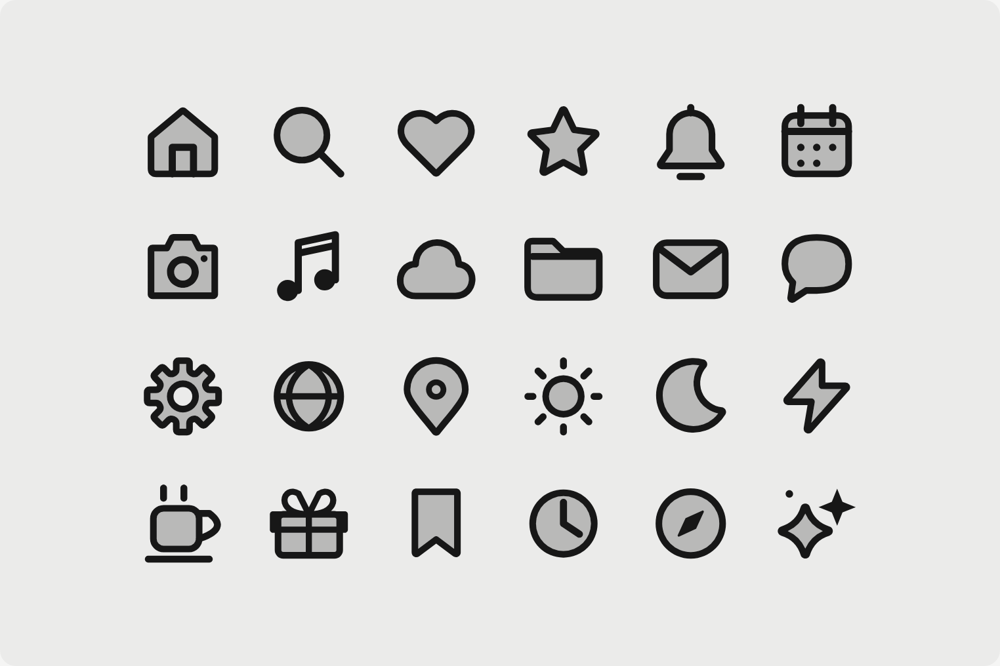

# Design system

### Words first. Everything else in their service.

A design system for **text-led websites**. Large reading type, hairline figures, mono labels and a single orange accent, defined so completely that a person or an agent can build a page that looks right the first time.

[Read the system](https://hugocxl.github.io/design-system/) · [Hand it to an agent](https://hugocxl.github.io/design-system/#agents) · [Visit the website](https://hugocxl.github.io/design-system/)

## Calm by default

Reading type carries every page, and nothing is set larger than the title. Line drawings explain instead of decorate. The orange accent appears at most twice, so when it shows up, it means something.

## A closed vocabulary

Thirteen components and six page recipes cover a home page, articles, docs, changelogs, pricing and contact. Every color, size and space is a token, and every rule can be checked in a browser. What isn't in the system isn't part of it.

## Made to feel at home

- **Ready for agents.** One file holds the whole definition, so an agent builds the same page from the same plan, every time.
- **Light and dark.** Every token has both, and pages follow the reader's preference.
- **Accessible from the start.** Readable contrast, keyboard-friendly controls and layouts that hold from a phone to a wide screen.
- **Free to use.** Open source, for personal and commercial work.

## Part of a stack

Three libraries, designed to work as one.

- **[Icons](https://hugocxl.github.io/icons/)** label what people can do.
- **[Vectors](https://hugocxl.github.io/vectors/)** illustrate what you mean.
- **[Design system](https://hugocxl.github.io/design-system/)** gives them the type, color and space to live in.

## License

The system is [MIT licensed](LICENSE). It ships the [Geist](https://vercel.com/font) typefaces under their [own license](system/fonts/Geist-LICENSE.txt) and the line drawings from [Hairline](https://github.com/lucasmarkes/hairline) under [theirs](system/figures/LICENSE). Its paper, orange and reading scale take after [Superlogical](https://www.superlogical.com/).

Made by [Hugo](https://github.com/hugocxl). Ideas and contributions are welcome: [open an issue](https://github.com/hugocxl/design-system/issues).
