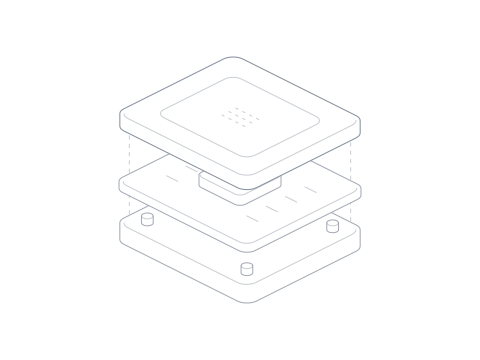

# P9 Figures

50 static isometric SVG illustrations for landing pages, feature sections, documentation, and product UI.

[Browse the gallery](https://hugocxl.github.io/p9-figures/) · [See all 50 SVG files](figures/)

| Modular design | Product architecture | Fast performance |
| :---: | :---: | :---: |
| [](figures/modular-design.svg) | [](figures/product-architecture.svg) | [](figures/fast-performance.svg) |

## Collections

- **Product** covers architecture, performance, responsive design, customization, integrations, and extensibility.
- **Workflow** covers collaboration, automation, planning, scheduling, search, and publishing.
- **Infrastructure** covers cloud services, storage, backups, load balancing, failover, and bandwidth.
- **Data** covers analytics, growth, forecasting, monitoring, and experiments.
- **Trust & control** covers security, permissions, privacy, approvals, recovery, and feature flags.

## Use an SVG

Copy any SVG from `figures/` into your project and reference it as an image. Every figure uses a transparent 480 × 360 viewBox and includes a title and description.

```html

```

To recolor a file, edit the root `color` attribute. For inline SVG, override its `color` with CSS. The separate stroke opacities preserve the hierarchy between highlights, contours, and construction lines.

## Build from source

The assets and gallery are checked in. To regenerate them, use Python 3.10–3.13 in a virtual environment.

```sh
python3 -m venv .venv
source .venv/bin/activate
python -m pip install -r requirements.txt
python scripts/build.py
python scripts/build.py --check
```

The scene definitions live in `scripts/scenes/`. The build projects their 3D coordinates into SVG and removes hidden lines so the backdrop stays transparent. Open `index.html` to browse the gallery locally.

## License

The artwork and source are [MIT licensed](LICENSE). The figure design draws on the visual rules in [Hairline by Lucas Marques](https://hairline.lucasmarkes.com/skills).
