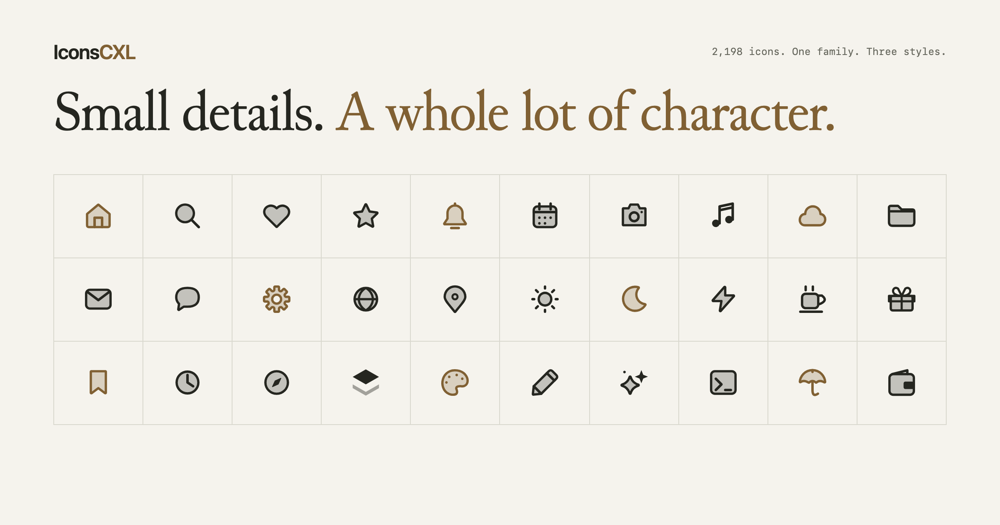

# Icons

### Small details. A whole lot of character.

A family of **2,233 rounded icons** for the things you build. From everyday navigation to creative tools, bring a clear, consistent visual language to your apps and websites.

[Browse the icons](https://hugocxl.github.io/icons/icons.html) · [Get started](https://hugocxl.github.io/icons/guide.html) · [Website](https://hugocxl.github.io/icons/)

## One family. Three expressions.

**Duotone** adds a quiet sense of depth. **Solid** brings emphasis. **Stroke** keeps things light. Choose the expression that suits your interface, with a shared rounded character across all three.

The collection includes 2,152 interface icons in all three styles, plus 81 brand marks in their default style.

## At home in your product

- **Made to work together.** Consistent shapes and proportions, from your first toolbar to your last settings screen.
- **Make them yours.** Explore different sizes and colors, then copy or download the icon you need.
- **Across your platforms.** Ready for the web, React, React Native, Expo, SwiftUI, UIKit, and AppKit.
- **Free to build with.** Open source, with original artwork available for personal and commercial projects under the MIT license.

## Find your next icon

[Explore the full collection →](https://hugocxl.github.io/icons/icons.html)

Search by name or category, compare styles, and preview an icon before bringing it into your project. The [getting started guide](https://hugocxl.github.io/icons/guide.html) covers every supported platform.

Created by [Hugo](https://github.com/hugocxl), growing out of the icon collection for [Tab](https://hugocxl.github.io/tab/).

## Contribute

Ideas, issues, and contributions are welcome. See the [contributing guide](CONTRIBUTING.md) or [open an issue](https://github.com/hugocxl/icons/issues).

## License and attribution

Original Icons artwork, Tab contributions and tooling are [MIT licensed](LICENSE).
The collection includes artwork adapted from Pierre Icons (Apache 2.0),
Pierre's file icons (MIT), Simple Icons (CC0 1.0), LobeHub Icons (MIT), and
Devicon (MIT). Upstream artwork retains its original license; the collection
is not solely MIT licensed. Keep [NOTICE](NOTICE),
[the upstream license texts](THIRD_PARTY_LICENSES.md), and applicable copyright
notices with redistributed artwork.

Brand marks remain the trademarks of their owners. Inclusion does not imply
endorsement or grant trademark rights.
